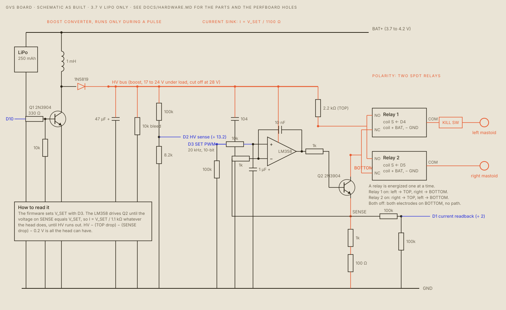

# HVAC: Human Vestibular Aversion Conditioner

> ## DANGER
> **This device passes electric current through your head. It can cause permanent damage.**
> It is a hackathon prototype (MakeUC 2026), not a medical device. Nobody has certified or reviewed it, and it comes with no warranty. If you build or run any of it, you are responsible for what happens to you and to anyone else. **Read [docs/SAFETY.md](docs/SAFETY.md) before you build, flash or wear anything.** Do not use it with epilepsy, an implant, a heart condition, a balance disorder, pregnancy, or irritated skin, and never while the board or the laptop is on a charger.

I wanted to see if I could make myself hate opening an app. I built a headband for it.

HVAC stands for Human Vestibular Aversion Conditioner. You pick what you want it to catch. When you do that thing, the headband makes you feel like you're tipping over. An electrode behind each ear sends a small current (never above 2.0 mA) that tips your sense of balance. It keeps doing it for as long as the app stays open.

It watches the network traffic of every device you own, so it doesn't matter whether the app opens on a phone or a laptop. There's also a fun mode: friends join the UNO Q's hotspot and steer your head left and right from their phones, like a radio-controlled car.

- Field notes from its future: https://aryagarg23.com/futures/hvac
- The hackathon writeup: https://aryagarg23.com/writing/hvac
- The pitch video and the video of a friend steering me are on the field notes page.

## How it works

```
devices on Tailscale → UNO Q → tshark packet lines → name the flows → 3 s windows
   → match against a recording → rules (Nauseate / Never / Auto) → two matches in a row → fire
   → Bluetooth → XIAO ESP32-C3 → current sink + relays → electrodes behind the ears
```

- **Hardware:** a battery-powered current source. A XIAO ESP32-C3 sets the current. A boost converter makes the high voltage, an LM358 and a 2N3904 hold the current steady, two relays flip the direction, and a physical kill switch cuts the circuit. [docs/HARDWARE.md](docs/HARDWARE.md)
- **Software:** the UNO Q captures packets and runs a pure-Python classifier. To teach it what to catch, you record two minutes of whatever you want punished. TRIBE v2 can lower how strongly a category fires. A dashboard on the UNO Q lets you set each app to Nauseate, Never or Auto. [docs/SOFTWARE.md](docs/SOFTWARE.md)
- **Safety by design:** the firmware caps the current at 2.0 mA, a pulse at 3 s, a pulse every 5 s, 30 pulses an hour and 30 minutes of live current an hour. The software can't ask for more. [docs/SAFETY.md](docs/SAFETY.md)

<picture><source media="(prefers-color-scheme: dark)" srcset="docs/figures/schematic-dark.svg"></picture>

## Status

- **Builder's report, 2026-11-08:** it works end to end. Traffic reaches the UNO Q, an enrolled category matches, and the headband fires. A friend steered the wearer from their phone in fun mode.
- **Results:** I have been nauseous since 3:30 a.m. My friend who tested it was nauseous too.
- **Checked by an automated test:** the pipeline and dashboard (97 tests), the UNO Q's msgpack encoder (3), the board layout.
- **Measured by hand:** the boost, the current into a dummy load, the relays, a first on-head session that found a bad electrode connection. All in [docs/TESTING.md](docs/TESTING.md).
- **Not done:** there is no measurement of head and electrode resistance, no true load-current readback, no impedance check before stimulating, and no isolation from the USB port. [docs/HARDWARE.md](docs/HARDWARE.md) lists them.

## Where everything is

| Path | What |
|---|---|
| [`docs/`](docs) | [SAFETY](docs/SAFETY.md) · [HARDWARE](docs/HARDWARE.md) · [PINOUT](docs/PINOUT.md) · [BUILD](docs/BUILD.md) · [TESTING](docs/TESTING.md) · [SOFTWARE](docs/SOFTWARE.md), and the figures in `docs/figures/` with the scripts that draw them |
| [`gvs/`](gvs) | The device: firmware, the perfboard layout and pictures, the SPICE model, the handoff, the debug notes, the bench log, the tools |
| [`pipeline/`](pipeline) | Packet lines → names → windows → classifier → rules → trigger → the link to the device. The dashboard |
| [`uno_q/`](uno_q) | The UNO Q: the LED matrix sketch, the capture script, fun mode, the pipeline's start script |
| [`tribe/`](tribe) | TRIBE v2 scoring of enrollment recordings, on a GPU box |
| [`research/`](research) | Sourced write-ups: GVS and safety, conditioning, traffic fingerprinting, the UNO Q as an exit node, TRIBE v2 |
| [`video/`](video) | The tools that cut the pitch video from real clips |
| [`legacy/`](legacy) | The first ESP32 serial controller and its SD card, superseded by `gvs/` |

## Quick start

For the full order, with every check, read [docs/BUILD.md](docs/BUILD.md). In short:

```bash
python3 gvs/board/check.py                       # layout: "no placement errors"
gvs/tools/make_secrets.sh                        # random token and hotspot password (git-ignored)
arduino-cli compile --fqbn esp32:esp32:XIAO_ESP32C3 gvs/firmware/gvs_controller
arduino-cli upload  -p /dev/cu.usbmodem1101 --fqbn esp32:esp32:XIAO_ESP32C3 gvs/firmware/gvs_controller
python3 gvs/tools/bench.py limits                # dummy load, nobody attached: PASS or FAIL
cd pipeline && python3 -m venv .venv && .venv/bin/pip install pytest hypothesis && .venv/bin/python -m pytest -q
```

Dry-run the pipeline and its dashboard with no device and no current:

```bash
cd pipeline
python3 tools/demo_feed.py | python3 -m gvs_pipeline --store /tmp/demo/p.json --window 3 live --dashboard 8090
```

## The order matters

1. Safety, then the parts and the board, then the continuity checks.
2. Flash, then the battery feed wire, then the relays, then the boost.
3. Dummy loads, with nobody attached.
4. Only then a person: seated, a second person present, kill switch in hand, on battery, at 0.5 mA.

## Licence

No licence has been chosen yet.
