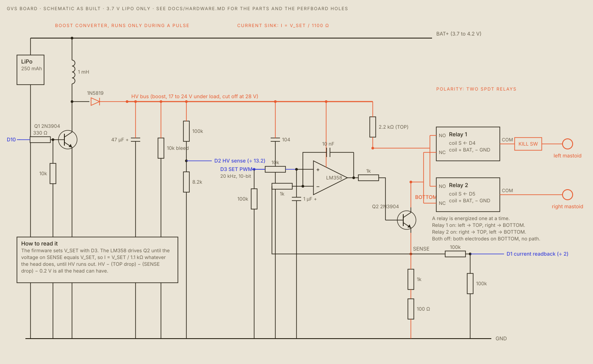
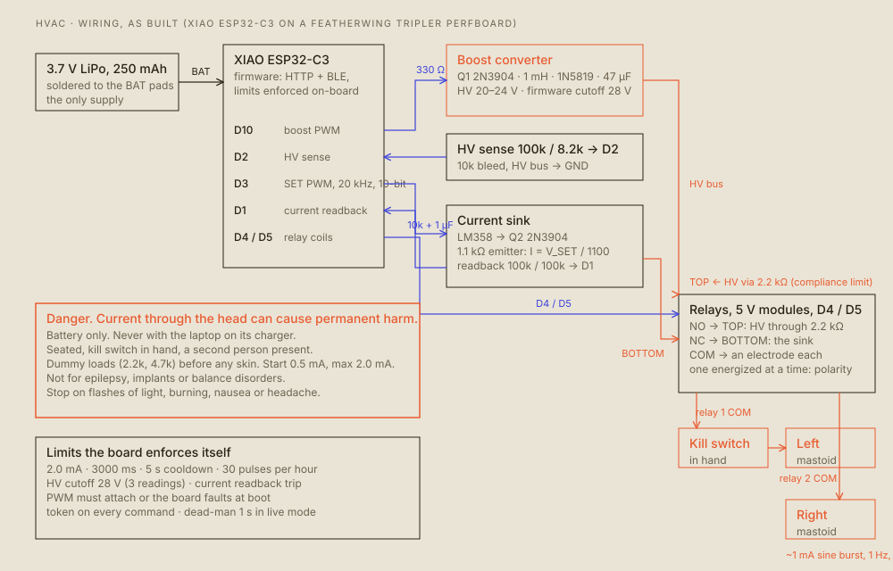
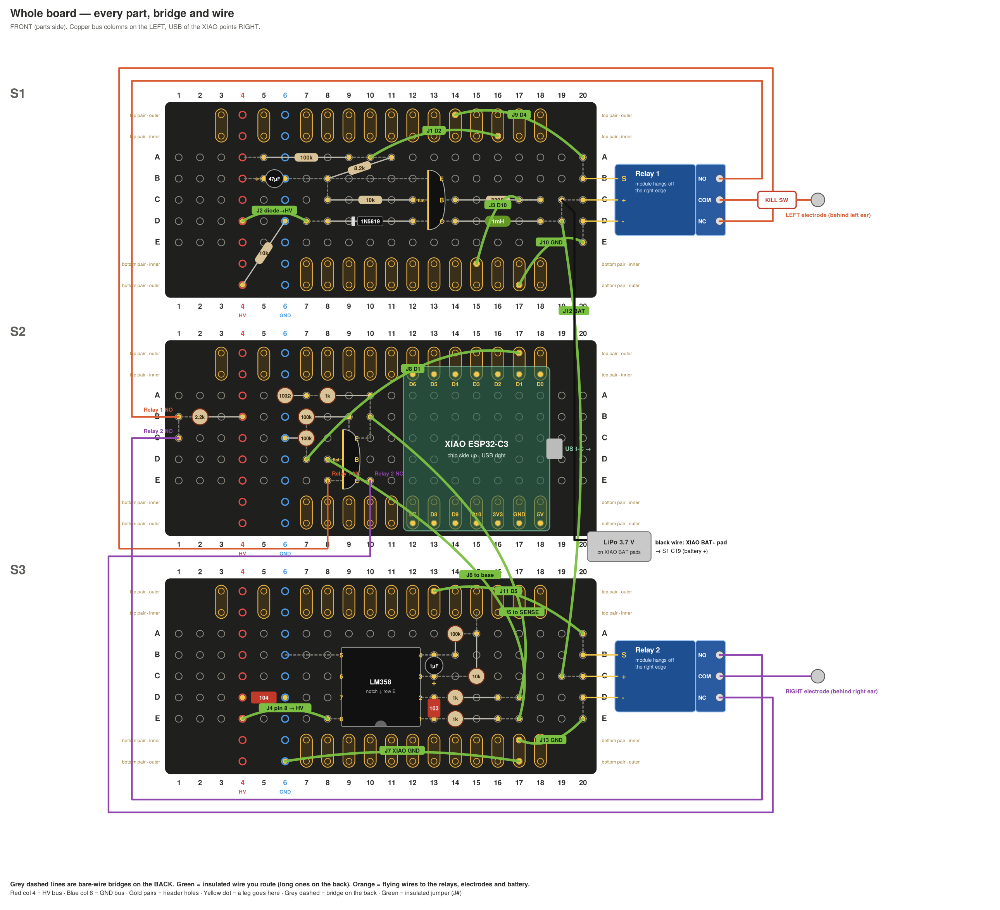

# Hardware

> **DANGER. This circuit puts current through your head and can cause permanent damage.** Read [SAFETY.md](SAFETY.md) first.

The device is a small battery-powered **current source** with two electrodes, one behind each ear. It sets a current, not a voltage, so the current stays the same when the electrode contact changes, until the supply runs out of voltage. A microcontroller sets the current, picks which electrode is positive, and watches the result.

*Schematic as built. Drawn from the soldered layout (`gvs/board/layout.py`), which also feeds the SPICE model (`gvs/board/sim.py`). Regenerate it with `python3 docs/figures/schematic.py docs/figures`.*

*The same board as blocks, with the limits the firmware enforces.*

## How it works

**Power.** One 3.7 V, 250 mAh LiPo is soldered to the XIAO's BAT pads. Nothing else powers the board. The battery rail feeds the relay coils and the boost converter, and the XIAO runs from it too.

**Boost converter.** An electrode circuit needs more than 3.7 V to push 1 to 2 mA through a few kilohms of skin. A 2N3904 (Q1) switches a 1 mH inductor from the XIAO's `D10` PWM, through a 330 Ω resistor. A 1N5819 diode charges a 47 µF capacitor on the HV bus. A 10 kΩ resistor bleeds the bus to ground, and a 100k / 8.2k divider feeds the HV voltage to `D2`, scaled by 13.2. The firmware runs the boost only during a pulse, so there is no high voltage at idle, and it cuts the boost off above 28 V.

**Current sink.** The LM358 op-amp and a 2N3904 (Q2) form a current sink, with a 1.1 kΩ sense resistor (1 kΩ + 100 Ω) in Q2's emitter. The XIAO's `D3` makes a 20 kHz, 10-bit PWM. A 10 kΩ + 1 µF filter turns that into a smooth voltage V_SET, and the op-amp drives Q2 until the sense voltage equals V_SET. So the current is `I = V_SET / 1100 Ω`. A duty of 0 gives a true 0 V and so exactly 0 mA. The hardware ceiling is about 3.0 mA at full duty (3.3 V / 1.1 kΩ), and the firmware caps it at 2.0 mA.

**Polarity.** The sink pulls current from a node called BOTTOM. The high side, TOP, is the HV bus through a 2.2 kΩ resistor. Two SPDT relays (5 V coil modules) connect each electrode to TOP or BOTTOM:
- Relay 1 on: left electrode on TOP, right on BOTTOM. Current flows left to right.
- Relay 2 on: right on TOP, left on BOTTOM. Current flows right to left.
- Both off: both electrodes on BOTTOM, which is the same node, so there is no path.

The firmware always passes through "both off" when it changes polarity, so the current is zero at every switch.

**Readback.** SENSE (Q2's emitter) goes through a 100k / 100k divider to `D1`, which the firmware reads as the current. It reads high at idle (0.25 to 0.28 mA with nothing flowing), and the firmware corrects it (`raw = 0.27 + 0.88 × true`, from the bench log). Note that the readback follows the *command*: it cannot see the current falling short of the command when the head resistance is too high. See [SAFETY.md](SAFETY.md).

**Kill switch.** A physical switch sits between relay 1's COM and the left electrode. It opens the circuit through the head.

**Headroom.** What the head and the electrodes can have is `HV − 0.2 V − (2.2 kΩ + 1.1 kΩ) × I`. The measured supply under load, and what that allows, from [`gvs/DEBUG.md`](../gvs/DEBUG.md):

| Current | HV under load | Largest head and electrode resistance that still gets the full current |
|---|---|---|
| 1.0 mA | 18.8 V | 15 kΩ |
| 1.5 mA | 17.5 V | 8.2 kΩ |
| 2.0 mA | 17.0 V | 5.1 kΩ |

Good contact on the mastoid is about 0.8 to 5 kΩ. These figures are arithmetic from the measured supply, not measured on a head.

## Bill of materials

| Qty | Part | Where |
|---|---|---|
| 1 | Seeed XIAO ESP32-C3 | the microcontroller (BLE, WiFi, ADC, PWM) |
| 1 | Particle FeatherWing Tripler perfboard | the board, three sections: S1 top, S2 middle, S3 bottom |
| 1 | LiPo 3.7 V, 250 mAh | soldered to the XIAO BAT pads |
| 2 | 2N3904 NPN | Q1 (boost switch), Q2 (current sink) |
| 1 | LM358 dual op-amp | one half used; the other half's pins are tied off on the board |
| 1 | 1N5819 Schottky diode | boost output |
| 1 | 1 mH inductor | boost |
| 1 | 47 µF electrolytic capacitor | HV bus |
| 1 | 1 µF electrolytic capacitor | SET filter |
| 1 | 100 nF capacitor (marked 104) | LM358 supply decoupling |
| 1 | 10 nF capacitor (marked 103) | op-amp feedback, output to the inverting input |
| 1 | 330 Ω resistor | Q1 base |
| 1 | 100 Ω resistor | with a 1 kΩ, the 1.1 kΩ sense resistor |
| 3 | 1 kΩ resistors | the sense resistor, the op-amp feedback input, and the Q2 base drive |
| 1 | 2.2 kΩ resistor | TOP (series, sets the compliance limit and limits a fault current) |
| 1 | 8.2 kΩ resistor | HV sense divider |
| 3 | 10 kΩ resistors | HV bleed, Q1 base pull-down, SET filter |
| 4 | 100 kΩ resistors | HV sense divider (top), `D3` pull-down, readback divider (2) |
| 2 | Tongling JQC-3FF-S-Z relay modules, 5 V coil | polarity; pins S, +, − |
| 1 | switch (SPST, panel or inline) | the kill switch |
| 2 | TENS or ECG electrodes with 2 mm sockets, and 2 mm male pins | the head. Fresh gel pads every session |
| – | hookup wire, headers, USB-C cable | |

Part values are the ones soldered (`gvs/board/layout.py`); the 1 µF cap and the 47 µF cap are polarized, and so is the orientation of the diode.

## The perfboard

The Tripler has three 20-column sections. Column 4 is the HV bus on every section, and column 6 is the ground bus. The header rows next to the sections are joined per column across all three.

| Section | What is on it |
|---|---|
| **S1 (top)** | the boost converter: Q1, the 1 mH inductor, the 1N5819, the 47 µF, the bleed, the HV sense divider. Relay 1 plugs in at column 20 |
| **S2 (middle)** | the XIAO in the header rows (USB-C pointing right, off the column-20 edge), Q2, the 1.1 kΩ sense resistors, the readback divider, the 2.2 kΩ TOP resistor |
| **S3 (bottom)** | the LM358 and its input network (the SET filter, feedback and base resistors, the 104 and 103 capacitors). Relay 2 plugs in at column 20 |

The pictures in [`gvs/pictures/`](../gvs/pictures) show every part, bridge and wire:
- `full_front.png`: the whole board, front
- `S1_front.png`, `S2_front.png`, `S3_front.png`: each section, front
- `S1_back.png`, `S2_back.png`, `S3_back.png`: the bridges on the back
- `test_points.png` and `probe_steps.png`: where to put the meter probes
- `electrode_placement.png` (and `.svg`): where the pads go behind the ears

The exact hole-by-hole layout is in `gvs/board/layout.py`, and `python3 gvs/board/check.py` checks every net. The long insulated jumpers:

| Jumper | From → to | What it carries |
|---|---|---|
| J1 D2 | S1 A10 → S1 header T16 | HV sense to the XIAO `D2` |
| J2 diode→HV | S1 D7 → S1 D4 | the diode's output to the HV bus |
| J3 D10 | S1 C17 → S1 header V15 | the boost drive from the XIAO `D10` |
| J4 pin 8→HV | S3 E8 → S3 E4 | the LM358 supply |
| J5 to SENSE | S3 D17 → S2 B10 | the feedback resistor to Q2's emitter |
| J6 to base | S3 E17 → S2 D8 | the op-amp output (through 1k) to Q2's base |
| J7 XIAO GND | S3 header W17 → S3 header W6 | ground |
| J8 D1 | S2 D7 → S2 header U17 | the readback to the XIAO `D1` |
| J9 D4 | S1 A20 → S1 header U14 | relay 1 coil to the XIAO `D4` |
| J10 GND | S1 E20 → S1 header W17 | relay 1 − to ground |
| J11 D5 | S3 A20 → S3 header U13 | relay 2 coil to the XIAO `D5` |
| J12 BAT | S3 C19 → S1 D19 | relay 2 + to the battery strip |
| J13 GND | S3 E20 → S3 header V17 | relay 2 − to ground |

Plus one black wire from the XIAO's BAT+ to **S1 D19**, which feeds the battery strip. Fit it only after the first flash (see [BUILD.md](BUILD.md)), and keep the solder small: D19 sits next to relay 1's − pin.

Rows `T` and `U` are the top header rows (inner and outer), and `V` and `W` the bottom ones. Pinout in [PINOUT.md](PINOUT.md).

## Electrodes

Behind each ear on the mastoid bone. Use round gel pads about 2 to 2.5 cm across (3 to 5 cm²), the same size on both sides, centred on the bone, on clean intact skin: alcohol, a light exfoliation, wipe off the residue, then the pad. Check gel-to-gel resistance between the two electrode leads before every session: under about 1 kΩ and steady when you wiggle the pins. A bare wire pushed into a pad's socket gives pain without a balance effect (that is what happened on 2026-11-07). Use 2 mm male pins.

## Things this circuit does not have

- A hardware current limit beyond the sink's own ceiling (about 3.0 mA at full duty) and the series resistors.
- A true load-current reading. The readback follows the command. `gvs/DEBUG.md` describes the divider that would fix it, and why the only free ADC1 pin (`D0`, GPIO2) is a boot-strapping pin.
- An impedance check that refuses to stimulate above 10 kΩ.
- Current readback at idle. Both relays sit on BOTTOM, so the electrodes are on the same node.
- Isolation from the USB port. See the charger path in [SAFETY.md](SAFETY.md).
