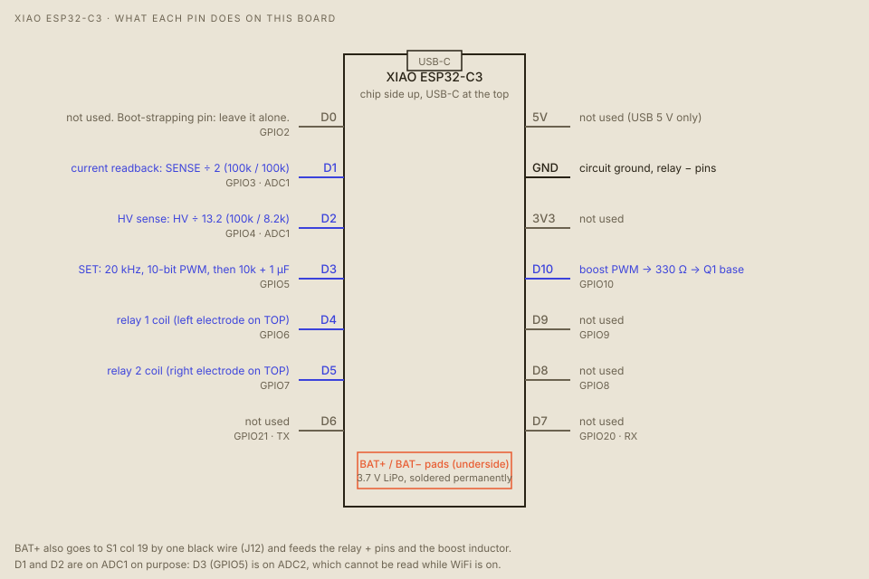

# Pinout

> **DANGER. Wrong wiring on this board can put the wrong current through your head.** Read [SAFETY.md](SAFETY.md) and check every connection with the tests in [BUILD.md](BUILD.md) before an electrode touches skin.

## XIAO ESP32-C3

| Pin | GPIO | Used for | Notes |
|---|---|---|---|
| `D0` | GPIO2 | not used | A boot-strapping pin. Don't hang anything on it without reading the C3 datasheet |
| `D1` | GPIO3 (ADC1) | current readback | SENSE → 100k → `D1` → 100k → GND, so the reading is half the sense voltage |
| `D2` | GPIO4 (ADC1) | HV sense | HV → 100k → `D2` → 8.2k → GND, divider 13.2 |
| `D3` | GPIO5 | SET | 20 kHz PWM, 10-bit, through 10k + 1 µF into the LM358's + input. A 100k pulls it to GND |
| `D4` | GPIO6 | relay 1 coil (S) | HIGH = on (the modules are active-high) |
| `D5` | GPIO7 | relay 2 coil (S) | HIGH = on |
| `D6` | GPIO21 | not used | |
| `D7` | GPIO20 | not used | |
| `D8` | GPIO8 | not used | |
| `D9` | GPIO9 | not used | |
| `D10` | GPIO10 | boost drive | PWM through 330 Ω into Q1's base. A 10k pulls the base to GND |
| `5V` | | not used | the USB 5 V |
| `3V3` | | not used | |
| `GND` | | ground | the circuit ground, and the relay − pins |
| `BAT+` / `BAT−` | | the LiPo | soldered permanently to the pads on the underside. BAT+ also goes by one black wire to S1 D19 |

**Why `D1` and `D2` and not `D3`:** on the ESP32-C3, `D3` (GPIO5) is on ADC2, which can't be read while WiFi is on. The two readings are on ADC1.

**Why 10-bit PWM:** the C3's LEDC clock is 40 MHz here, so 20 kHz × 2^bits has to fit. 11 and 12 bits fail to attach, and the firmware now faults at boot if either PWM does not attach. 10 bits gives about 3 µA per step.

## Relay modules (2 × Tongling JQC-3FF-S-Z, 5 V coil)

The module's header has three pins, top to bottom: **S**, **+**, **−**. They plug into column 20.

| Pin | Goes to |
|---|---|
| S | the XIAO: relay 1 `D4`, relay 2 `D5` |
| + | the battery strip (BAT+) |
| − | ground |

Contacts, on the module's screw terminals:

| Terminal | Goes to |
|---|---|
| NO | TOP (the HV bus through 2.2 kΩ) |
| NC | BOTTOM (the collector of Q2, the current sink) |
| COM | an electrode. Relay 1 COM goes through the kill switch to the left electrode. Relay 2 COM goes to the right electrode |

If a relay clicks the wrong way at idle, the module is active-low: set `RELAY_ACTIVE_LOW = true` in the firmware and reflash. Both relays should be off at idle (see [BUILD.md](BUILD.md)). The 5 V coils run from the 3.7 to 4.2 V battery, so a low battery may not pull them in.

## Perfboard holes

Hole addresses are *section, column, row* (`S1 D19` is section 1, column 19, row D). Rows A to E are the build rows, and `T`, `U`, `V`, `W` the header rows (`T` top-inner, `U` top-outer, `V` bottom-inner, `W` bottom-outer). Column 4 is the HV bus and column 6 the ground bus, on every section. The XIAO sits in S2's header rows with the USB-C pointing right:

| XIAO pin | Header hole (S2) |
|---|---|
| `D6`, `D5`, `D4`, `D3`, `D2`, `D1`, `D0` | row T, columns 12 to 18 |
| `D7`, `D8`, `D9`, `D10`, `3V3`, `GND`, `5V` | row W, columns 12 to 18 |

The long jumpers (J1 to J13) and the full hole map are in [HARDWARE.md](HARDWARE.md) and `gvs/board/layout.py`.

## Radio and network interfaces

| What | Detail |
|---|---|
| BLE | the device advertises as `GVS-zapper`. Service `6e7a0001-9c1b-4e5a-8f3d-67a5c0de0001`, command characteristic `…0002`, response `…0003` (same prefix). Each command is `<token> <command line>` |
| WiFi | off unless `secrets.h` has an SSID. With WiFi off the HTTP server does not start |
| USB serial | 115200 baud, the same command lines, no token |
| UNO Q ↔ XIAO | Bluetooth only. There is no wire between them |
| UNO Q MCU | the Arduino Router Bridge (msgpack-rpc): `show(bucket_index, intensity)`, `tilt(level)` and `clear()` draw on the LED matrix |

Commands, status codes and the HTTP API are in [SOFTWARE.md](SOFTWARE.md).
