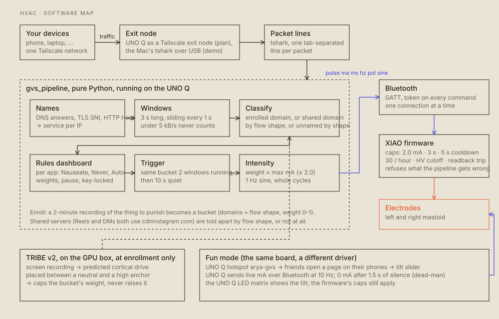

# Software

> **DANGER. The software decides when current goes through your head.** Its limits are real, but the firmware's are the ones that count. See [SAFETY.md](SAFETY.md).

<picture><source media="(prefers-color-scheme: dark)" srcset="figures/software-dark.svg"></picture>

*Regenerate the figures with `python3 docs/figures/site_figures.py docs/figures`. Every figure has a `-dark.svg` twin, which GitHub shows in dark mode.*

## The path of one stimulus

```
devices on the Tailscale network → UNO Q (exit node) → packet lines → names → 3 s windows
   → classify → rules → trigger (2 in a row, 10 s rest) → intensity → Bluetooth → firmware → electrodes
```

| Piece | Where | What it does |
|---|---|---|
| Firmware | [`gvs/firmware/gvs_controller/`](../gvs/firmware/gvs_controller) | The only thing that touches the current. Enforces the limits, runs the boost and the sink, reads back HV and current. BLE, USB serial and (optionally) HTTP |
| Capture | `uno_q/linux/capture.sh` | `tshark` on the Tailscale interface, one tab-separated line per packet, fixed columns |
| Pipeline | [`pipeline/`](../pipeline) | Pure Python standard library. Names flows, makes windows, classifies, applies rules, triggers, sends the stimulus |
| Rules and dashboard | `pipeline/gvs_pipeline/rules.py`, `dashboard.py` | Choose, per app, what makes you dizzy. A web page on the UNO Q |
| UNO Q | [`uno_q/`](../uno_q) | Runs the pipeline and its dashboard, the LED matrix sketch, and fun mode |
| Fun mode | `uno_q/fun/` | A hotspot and a page where friends tilt the wearer |
| Mac relay | `gvs/tools/ble_bridge.py` | One Bluetooth connection from the Mac, with a browser tilt page |
| TRIBE v2 | [`tribe/`](../tribe) | Scores an enrollment screen recording on a GPU box. Caps a bucket's weight |
| Video | [`video/`](../video) | The pitch video's cut-together tools |

## Firmware commands

The same command lines on BLE (each prefixed with the token: `<token> <line>`), USB serial (115200 baud, no token) and HTTP (`?token=`, only when WiFi is on). The BLE device is `GVS-zapper`.

| Command | What it does |
|---|---|
| `status` | JSON: mode, commanded and measured mA, relay state, HV, boost duty, cooldown, pulses logged, fault, last message |
| `pulse <ma> <ms> [hz] [pol] [sine\|dc]` | One pulse. `ma` is clamped to 2.0, `ms` to 3000, `hz` to 0.2 to 2, `pol` is 0 (left to right) or 1. `sine` is zero-mean whole cycles. `dc` is for threshold testing |
| `live <signed mA>` | Streams a target current. The board slews toward it at up to 4 mA/s (the sign picks the relay) and holds it while updates keep coming |
| `stop` | Output off, relays released |
| `boost <pct>` | Bench tuning: holds the boost on at `pct`, clamped to 45. `boost 0` ends tuning |
| `boostpct <pct>` | Uses this duty for pulses until reset |

Replies are `<code> <message>`:

| Code | Meaning |
|---|---|
| 200 | done |
| 400 | bad command or argument |
| 403 | bad token |
| 409 | busy, boost tuning is on, or `BOOST_PCT` isn't set yet |
| 423 | latched fault (`faulted: …`). Power cycle to clear |
| 429 | `cooldown` (5 s between pulses), `hourly_limit` (30 pulses), or `live_budget` (30 minutes of current per rolling hour) |

The firmware's limits are listed in [SAFETY.md](SAFETY.md).

## The pipeline

Full detail in [`pipeline/README.md`](../pipeline/README.md). In short:

- **Names.** DNS answers, TLS SNI and HTTP Host teach it which IP is which service, as the registrable domain (`tiktokv.com`).
- **Windows.** 3 s long, sliding every 1 s. A service under 5 kB/s in a window never counts.
- **Enroll.** Record about two minutes of only the thing you want punished. Services that carry at least 10% of the bytes or packets become the bucket's domains, and the bucket keeps its flow shape. `python -m gvs_pipeline enroll BUCKET capture.tsv --weight 0.9`. The weight is 0 to 1.
- **Classify.** A named service in one bucket is that bucket. A service shared by several buckets (Instagram Reels and DMs both use `cdninstagram.com`) is decided by flow shape against each bucket's shape for that domain, and only if the winner clearly beats the runner-up. A named service in no bucket does nothing. An unnamed flow goes to the nearest shape above a threshold.
- **Trigger.** The same bucket has to win two windows in a row. Then it fires and rests for ten seconds. If the traffic still matches after that, it fires again, so you stay dizzy for as long as the app stays open.
- **Intensity.** The bucket's weight × the current you set with `--max-ma` (never above 2.0), rounded down, as a whole number of 1 Hz sine cycles, 500 to 2000 ms.
- **TRIBE v2.** At enrollment, `--tribe` and `--tribe-anchors` cap the weight at TRIBE's predicted cortical drive for the screen recording. It can lower the weight and never raise it.

```bash
python -m gvs_pipeline enroll ig_reels reels_2min.tsv --weight 0.9
python -m gvs_pipeline enroll ig_dms   dms_2min.tsv   --weight 0      # same servers, weight 0
ssh unoq ./capture.sh | python -m gvs_pipeline live --relay --max-ma 0.5 --dashboard 8080
```

`live` without `--relay` or `--gvs` is a dry run that prints one JSON line per window and sends nothing.

## Rules and the dashboard

`rules.json` sits next to the store and is re-read every window, so an edit takes effect on the next second:

```json
{"paused": false,
 "services": {"tiktok.com": 0.8, "whatsapp.net": 0},
 "buckets":  {"ig_reels": {"on": true, "weight": 0.9}}}
```

- A **service rule** outranks the buckets: a weight fires that service even if it was never enrolled, and `0` vetoes it, whatever a bucket says.
- A **bucket** can be switched off or reweighted.
- **Pause** keeps deciding and showing, and fires nothing.
- The 5 kB/s floor, the two-window confirm and the ten-second rest still apply, and no weight can ask for more than `--max-ma`.

`live --dashboard PORT` serves the dashboard. It lists each service moving packets, each with **Nauseate / Never / Auto**, plus the rules, the enrolled buckets, the last stimuli and Pause. On localhost it needs no key. Off localhost every API call needs the key in `dashboard.key` (sent as `X-Dashboard-Key`, from the link's `#key=`), because the hotspot is shared with friends.

## On the UNO Q

- **Fun mode:** `uno_q/fun/start_fun.sh` starts a WiFi hotspot and a page. Friends join, open the page and tilt the wearer. The UNO Q holds the one Bluetooth connection to the XIAO, sends the current at 10 Hz, and drops it to 0 mA after 1.5 s of page silence. It uses the system `python3` with `bleak` and `dbus-fast` unpacked into `~/gvs/lib`, because the board has no internet. A cron job at boot starts a supervisor that restarts the server within 2 s if it dies.
- **The pipeline and its dashboard:** `uno_q/pipeline/start_pipeline.sh demo` runs it on synthetic traffic on the board, with no stimuli. `start_pipeline.sh mac IFACE [MA]` streams your Mac's `tshark` over USB into the board's pipeline, and with `MA` it stimulates through fun mode's Bluetooth link. The dashboard is on the hotspot at `http://10.42.0.1:8081/#key=…` and on the Mac at `http://127.0.0.1:18081/#key=…`.
- **Why packets come from the Mac in that script:** the board has no `tshark`, no internet to install it, and raw capture needs root there. The plan is the UNO Q as a Tailscale exit node (`research/uno_q_exit_node.md`), so every device's traffic passes through it.
- **LED matrix:** `uno_q/matrix_status/matrix_status.ino` shows the bucket and intensity (`show`) and the live tilt (`tilt`).

## Other tools

| Tool | Use |
|---|---|
| `gvs/tools/bench.py` | USB serial bench tests with PASS/FAIL |
| `gvs/tools/ble_bridge.py` | The Mac's Bluetooth relay and tilt page. Run in Terminal.app. Refuses current while the Mac is on its charger and the board is on USB |
| `gvs/tools/make_secrets.sh` | Random token and hotspot password, into the two git-ignored files |
| `gvs/tools/set_wifi.sh` | Put a WiFi SSID into `secrets.h` |
| `tribe/screen_chunks.py`, `serve.py` | The Mac screen chunker and the GPU box server for TRIBE's live feed |
| `video/` | The pitch video: `build.py`, the looks, and the generators for the scenes. See [`video/README.md`](../video/README.md) |

## Secrets

`gvs/firmware/gvs_controller/secrets.h` (the token, the WiFi credentials, the hotspot password) and `gvs/device.env` are in `.gitignore`. Don't commit them, and don't leave the example values.
